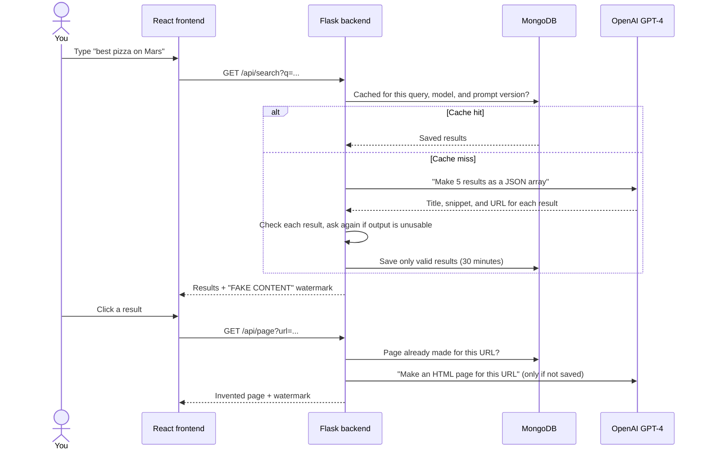
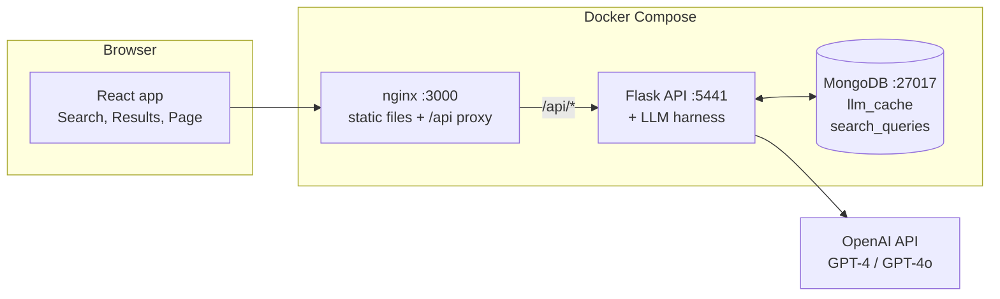
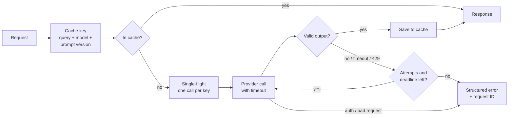

<p align="center">
  
</p>

<p align="center"><b>A search engine where every result is made up.</b></p>

Giggle looks and works like a normal web search. But it does not crawl or index the web. A large language model (LLM) invents every search result and every page that you open. Each response has a warning label.

The project asks one question: **if an AI answer looks like a search result, do people still check it?** Giggle shows how easily a plausible interface makes invented content look true.

## What happens when you search



Giggle keeps each invented page until the prompt changes. If you open the same URL again, you see the same page, as with a real website.

## Architecture



| Endpoint | What it does | Model | Cache |
| --- | --- | --- | --- |
| `GET /api/search?q=` | Invents five search results | GPT-4 | 30 minutes for each query |
| `GET /api/page?url=` | Invents an HTML page for a URL | GPT-4 | Until the prompt version changes |
| `GET /api/search/history` | Lists your recent searches | — | — |
| `GET /api/roast` | Writes a joke about your last 10 searches | GPT-4o | None |
| `GET /api/metrics` | Shows counters for cache hits, provider calls, retries, and errors | — | — |

Run the backend with `python app.py --crazy` to make the content more absurd and to change the watermark.

## Quick start

### Prerequisites

- Docker 20.10 or later, with Docker Compose v2
- An OpenAI API key

### Procedure

1. Clone the repository:

   ```sh
   git clone https://github.com/NickZhuxy/Giggle.git
   cd Giggle
   ```

2. Copy the example settings file. Then put your key in `OPENAI_API_KEY` in `.env`:

   ```sh
   cp .env.example .env
   ```

3. Build and start the three services:

   ```sh
   docker compose up -d --build
   ```

4. Open http://localhost:3000.

### Run the tests

The tests use a scripted fake provider, so they do not call OpenAI and do not need a key.

```sh
python -m pip install pytest pytest-cov flask flask-cors pymongo openai python-dotenv mongomock
OPENAI_API_KEY=test pytest --cov=app --cov=harness tests/test_app.py tests/test_frontend.py tests/test_harness.py
```

The suite has 41 tests with 85% coverage (lines and branches) of `app.py` and `harness/`. Continuous integration (CI) fails if coverage drops below 80%. `tests/test_db.py` needs a running MongoDB; CI starts one.

## Project structure

```text
app.py              Flask API routes and structured errors
harness/            LLM client, output checks, cache, coalescing, and metrics
bench/              Benchmark with simulated faults, and saved results
database/           MongoDB connection, models, and history queries
frontend/           React app, nginx settings, and Dockerfile
tests/              pytest tests for the API, the harness, the database, and static file serving
.github/workflows/  Lint, tests, and a manual Docker Hub deployment
```

## Reliable LLM calls

A model API can be slow, fail, or return text that is not valid JSON. Every LLM call in Giggle goes through one harness (`harness/`) that makes this behavior predictable.



- **Validation.** The harness repairs JSON, then checks the type and content of each result. If a response is cut off, the harness keeps only complete results. It asks again if fewer than three are valid.
- **Bounded retries.** Timeouts, rate limits, server errors, and unusable output cause a retry with exponential backoff. One request makes at most three calls and stops at a 45-second deadline. Authentication and request errors do not cause a retry.
- **Correct caching.** The cache key contains the normalized query, the model, the prompt version, and the generation settings. A new prompt version makes old entries unusable. Failed calls are never cached.
- **Coalescing.** When identical requests arrive at the same time, only the first request calls the model. The other requests wait and get the same result. This works in one server process only.
- **Clear errors.** The API returns a `5xx` status with an error type and a request ID. It never returns keys or stack traces.

### Benchmark

The benchmark sends one request trace through four request paths. Each path adds one mechanism to the path before it. A simulated provider adds faults and latency.

```sh
python -m bench.run_benchmark --out bench/results/latest
```

| Metric | A original | B harness | C + cache | D + coalescing |
| --- | ---: | ---: | ---: | ---: |
| Valid responses | 85.8% | 98.6% | 99.5% | 99.9% |
| Invalid output served to user | 11.8% | 0.0% | 0.0% | 0.0% |
| Errors returned | 2.4% | 1.4% | 0.5% | 0.1% |
| Provider calls per request | 0.23 | 1.30 | 0.29 | 0.17 |
| p95 latency (ms) | 111 | 326 | 178 | 151 |

Conditions: 400 requests over 60 distinct queries with repeats, 16 concurrent clients, mean of 3 seeds. For each provider call, the simulated provider adds 25% faults: timeouts 4%, rate limits 6%, prose instead of JSON 6%, truncated output 5%, and wrong fields 4%. These numbers come from a simulation. They are not measurements of the OpenAI API. See [`bench/results/2026-10-13/`](bench/results/2026-10-13/) for the results of each seed.

What the results show:

- The original path cached any output that it could parse, including results with wrong fields. It then served that output again for 30 minutes.
- Retries make the harness correct, but they cost more calls (B). The cache removes most of that cost (C). Coalescing removes duplicate calls for popular queries: 40% fewer provider calls than C.
- The harness has a higher p95 latency than the original path, because a retry takes time. A fast error is not a useful response.

## Team

Giggle started as a four-person project for NYU Software Engineering (Spring 2025):
[Sophia Gu](https://github.com/Sophbx),
[Hans Yin](https://github.com/Hans-Yin),
[Zifan Zhao](https://github.com/Exiam6), and
[Nick Zhu](https://github.com/NickZhuxy).

This repository continues that project. It does not include the original Git history. It keeps the original GPL license.
