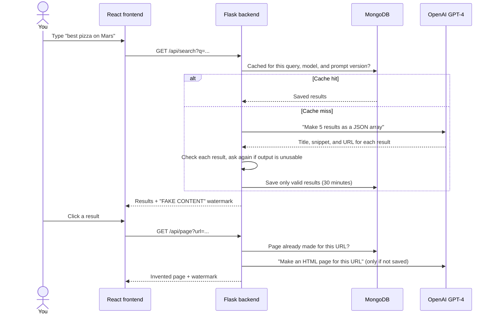
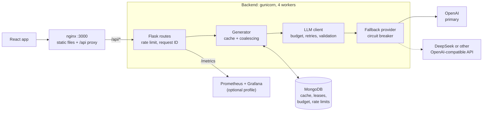
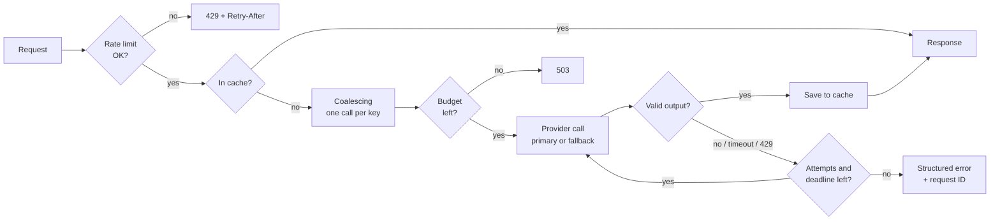
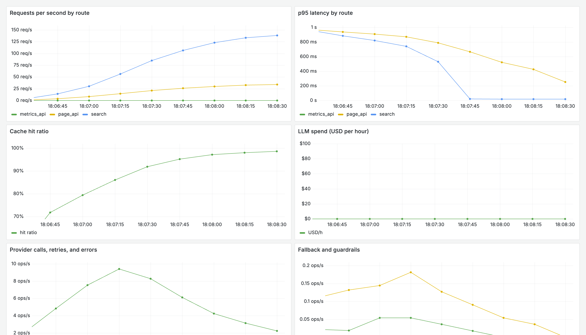

<p align="center">
  
</p>

<p align="center"><b>A search engine where every result is made up.</b></p>

Giggle looks and works like a normal web search. But it does not crawl or index the web. A large language model (LLM) invents every search result and every page that you open. Each response has a warning label.

The project asks one question: **if an AI answer looks like a search result, do people still check it?** Giggle shows how easily a plausible interface makes invented content look true.

## What happens when you search



Giggle keeps each invented page until the prompt changes. If you open the same URL again, you see the same page, as with a real website.

## Architecture



| Endpoint | What it does | Model | Cache |
| --- | --- | --- | --- |
| `GET /api/search?q=` | Invents five search results | GPT-4 | 30 minutes for each query |
| `GET /api/page?url=` | Invents an HTML page for a URL | GPT-4 | Until the prompt version changes |
| `GET /api/search/history` | Lists your recent searches | — | — |
| `GET /api/roast` | Writes a joke about your last 10 searches | GPT-4o | None |
| `GET /api/metrics` | Shows the counters of this worker process as JSON | — | — |
| `GET /metrics` | Prometheus metrics, summed across all workers | — | — |

## Quick start

### Prerequisites

- Docker 20.10 or later, with Docker Compose v2.24 or later
- An OpenAI API key, if you do not use demo mode

### Procedure

1. Clone the repository:

   ```sh
   git clone https://github.com/NickZhuxy/Giggle.git
   cd Giggle
   ```

2. Copy the example settings file. Then do one of these steps in `.env`:
   - Put your key in `OPENAI_API_KEY`.
   - Or set `GIGGLE_FAKE_LLM=1` for demo mode. In demo mode, a simulated provider invents the content. You do not need a key, and the run costs nothing.

   ```sh
   cp .env.example .env
   ```

3. Build and start the services:

   ```sh
   docker compose up -d --build
   ```

4. Open http://localhost:3000.

5. Optional: start Prometheus and Grafana too. Then open the dashboard at http://localhost:3001:

   ```sh
   docker compose --profile observability up -d
   ```

`.env.example` lists every setting: the daily budget, the rate limit, model prices, the fallback provider, and the number of workers.

### Run the tests

The tests use a scripted fake provider, so they do not call OpenAI and do not need a key.

```sh
python -m pip install pytest pytest-cov flask flask-cors pymongo openai python-dotenv mongomock prometheus_client
OPENAI_API_KEY=test pytest --cov=app --cov=harness tests/test_app.py tests/test_frontend.py tests/test_harness.py
```

Continuous integration (CI) fails if coverage drops below 80%. `tests/test_db.py` needs a running MongoDB; CI starts one.

## Project structure

```text
app.py              Flask routes, rate limit, structured errors, logs
harness/            LLM client, output checks, cache, coalescing, fallback,
                    guardrails, and observability
bench/              Benchmarks, the prompt evaluation, and saved results
database/           MongoDB connection, collections, and indexes
frontend/           React app, nginx settings, and Dockerfile
observability/      Prometheus settings and the Grafana dashboard
gunicorn.conf.py    Worker settings and start-up tasks
tests/              pytest tests for the API, the harness, the database, and static files
.github/workflows/  Lint, tests, and continuous deployment (CD)
```

## Reliable LLM calls

A model API can be slow, fail, or return text that is not valid JSON. Every LLM call in Giggle goes through one harness (`harness/`) that makes this behavior predictable.



- **Validation.** The harness repairs Markdown fences, trailing commas, invalid escapes, control characters, and invalid Unicode. Then it checks the type and content of each result. If a response is cut off, the harness keeps only complete results. It asks again if fewer than three are valid.
- **Bounded retries.** Timeouts, rate limits, server errors, and unusable output cause a retry with exponential backoff. One request makes at most three calls and stops at a 45-second deadline. Authentication and request errors do not cause a retry.
- **Correct caching.** The cache key contains the normalized query, the model, the prompt version, and the generation settings. A new prompt version makes old entries unusable. Failed calls are never cached.
- **Coalescing.** When identical requests arrive at the same time, only one request calls the model. Inside one process, the other requests wait on a lock. Across gunicorn workers, a lease document in MongoDB gives one worker the call, and the other workers wait for its result in the cache.
- **Fallback.** If the primary provider times out, rate-limits, or is down, the call goes to a second provider. After 5 failures in a row, a circuit breaker skips the primary for 30 seconds. Fallback answers are served but not cached.
- **Guardrails.** Each call is priced from its token counts. A daily budget, shared by all workers, stops model calls when it is spent. Each client IP address can send 30 requests per minute to the search, page, and roast endpoints.
- **Clear errors.** The API returns a `4xx` or `5xx` status with an error type and a request ID. It never returns keys or stack traces.

## Results

| What was measured | Result |
| --- | --- |
| Valid responses under 25% injected faults | 85.8% (original code) → 99.9% (harness, cache, and coalescing) |
| Invalid output shown to users | 11.8% → 0% |
| Provider calls saved by coalescing, compared with the cache only | 41% |
| Provider calls saved by the cache | About equal to the share of repeated queries: 58% at 59% repeats |
| Valid responses during a provider outage | 63.7% without fallback → 100% with fallback |
| Calls to a dead provider stopped by the circuit breaker | 81% |
| 20 identical concurrent requests across 4 worker processes | 1 provider call |

All results come from simulated providers. They are not measurements of the OpenAI API. Read [the benchmark details](docs/benchmarks.md) for the conditions, the commands, and the per-seed data.

A real-model comparison of prompt versions and models is ready in `bench/prompt_eval.py`, but it has not been run yet.

## Observability

Each request writes one JSON log line with its request ID, route, status, latency, cache result, and model. The `/metrics` endpoint gives Prometheus the counters of all workers. The Grafana dashboard shows traffic, latency, the cache hit ratio, spend, provider errors, and fallbacks.

<p align="center">
  
</p>

<p align="center"><i>Demo mode, 12 clients for two minutes, starting with an empty cache. The hit ratio rises to about 98%, and p95 search latency falls as the cache fills. Spend stays at $0 because demo mode calls no paid model.</i></p>

## Deployment

The `CD Deploy` workflow starts after `Flask CI` passes on `main`. It builds the backend and frontend images, pushes them to Docker Hub with the `latest` tag and the commit tag, and then updates the server over SSH. If the secrets are not set, the workflow skips these steps. Set these repository secrets to turn on deployment: `DOCKERHUB_USERNAME`, `DOCKERHUB_TOKEN`, `DO_SERVER_IP`, `DO_SSH_USER`, and `SSH_PRIVATE_KEY`. The server must have a clone of this repository at `/srv/giggle` and a `.env` file.

## Team

Giggle started as a four-person project for NYU Software Engineering (Spring 2025):
[Sophia Gu](https://github.com/Sophbx),
[Hans Yin](https://github.com/Hans-Yin),
[Zifan Zhao](https://github.com/Exiam6), and
[Nick Zhu](https://github.com/NickZhuxy).

This repository continues that project. It does not include the original Git history. It keeps the original GPL license.
