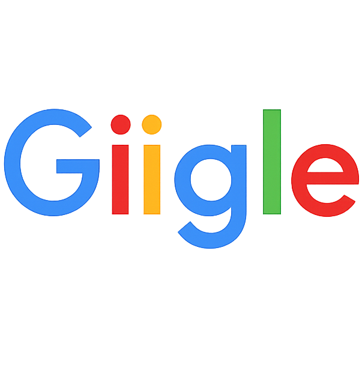
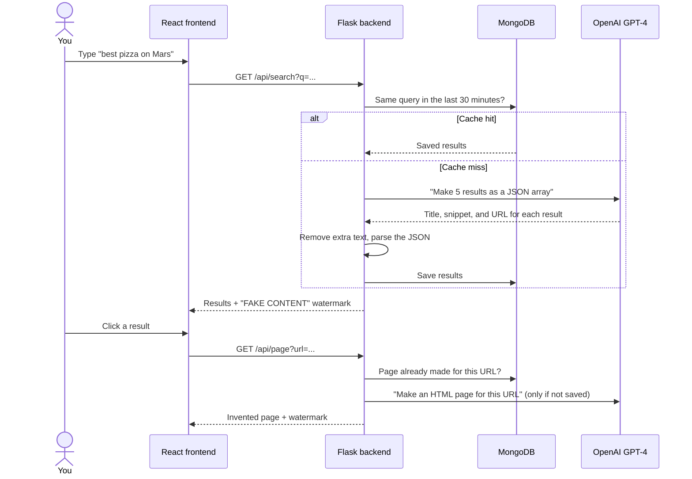
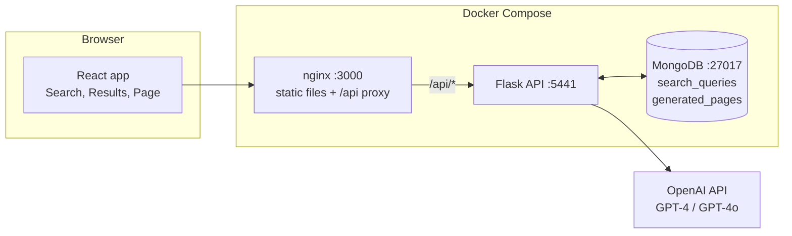

<p align="center">
  
</p>

<p align="center"><b>A search engine where every result is made up.</b></p>

Giggle looks and works like a normal web search. But it does not crawl or index the web. A large language model (LLM) invents every search result and every page that you open. Each response has a warning label.

The project asks one question: **if an AI answer looks like a search result, do people still check it?** Giggle shows how easily a plausible interface makes invented content look true.

## What happens when you search



Giggle saves each invented page permanently. If you open the same URL again, you see the same page, as with a real website.

## Architecture



| Endpoint | What it does | Model | Cache |
| --- | --- | --- | --- |
| `GET /api/search?q=` | Invents five search results | GPT-4 | 30 minutes for each query |
| `GET /api/page?url=` | Invents an HTML page for a URL | GPT-4 | Permanent for each URL |
| `GET /api/search/history` | Lists your recent searches | — | — |
| `GET /api/roast` | Writes a joke about your last 10 searches | GPT-4o | None |

Run the backend with `python app.py --crazy` to make the content more absurd and to change the watermark.

## Quick start

### Prerequisites

- Docker 20.10 or later, with Docker Compose v2
- An OpenAI API key

### Procedure

1. Clone the repository:

   ```sh
   git clone https://github.com/NickZhuxy/Giggle.git
   cd Giggle
   ```

2. Copy the example settings file. Then put your key in `OPENAI_API_KEY` in `.env`:

   ```sh
   cp .env.example .env
   ```

3. Build and start the three services:

   ```sh
   docker compose up -d --build
   ```

4. Open http://localhost:3000.

## Project structure

```text
app.py              Flask API, prompts, and JSON clean-up
database/           MongoDB connection, models, and cache queries
frontend/           React app, nginx settings, and Dockerfile
tests/              pytest tests for the API, the database, and static file serving
.github/workflows/  Lint, tests, and a manual Docker Hub deployment
```

## Roadmap

The next stage makes the LLM calls reliable and measurable. It adds one shared client with timeouts and bounded retries, schema checks after JSON repair, cache keys that include the prompt version, and a repeatable cost and latency benchmark. These items are planned. They are not in the code yet.

## Team

Giggle started as a four-person project for NYU Software Engineering (Spring 2025):
[Sophia Gu](https://github.com/Sophbx),
[Hans Yin](https://github.com/Hans-Yin),
[Zifan Zhao](https://github.com/Exiam6), and
[Nick Zhu](https://github.com/NickZhuxy).

This repository continues that project. It does not include the original Git history. It keeps the original GPL license.
